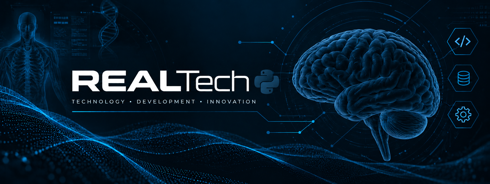

  

 

### Desarrollo de Aplicaciones Multiplataforma · HealthTech

**Tecnología con propósito. Soluciones que conectan con las personas.**

---

## 👨‍💻 Sobre mí

¡Hola! Soy **Diones Gomes**, estudiante de Formación Profesional Superior en **Desarrollo de Aplicaciones Multiplataforma (DAM)** en CEAC Valencia, España.

Estoy construyendo mi camino en el desarrollo de software a través de proyectos prácticos, curiosidad y aprendizaje continuo.

Me interesa crear aplicaciones útiles, intuitivas y accesibles, especialmente aquellas que conectan la tecnología con la salud y el bienestar.

- 🎓 Estudiante de DAM en CEAC Valencia.
- 💻 Aprendiendo programación y desarrollo de aplicaciones.
- 🗄️ Practicando SQL, bases de datos y operaciones CRUD.
- 🌐 Desarrollando proyectos con HTML, CSS y JavaScript.
- 🩺 Interesado en HealthTech y soluciones digitales para la salud.
- 🚀 Construyendo mi portfolio profesional paso a paso.

## 🛠️ Tecnologías y herramientas

*Tecnologías en aprendizaje y práctica; sigo ampliando mis conocimientos con cada proyecto.*

## 🚀 Proyectos destacados

### 🩺 NEXO: Salud Emocional

Proyecto académico de desarrollo web centrado en una interfaz clara y organizada para la gestión asistencial.

**Objetivo:** practicar diseño de interfaces y organización de información mediante secciones como pacientes, consultas e informes.

**Tecnologías:** HTML, CSS y las herramientas de desarrollo utilizadas en el proyecto.

### 🌐 Desarrollo web

Páginas y prototipos creados durante mi formación en DAM.

- Estructura semántica con HTML.
- Diseño visual con CSS.
- Práctica de JavaScript.
- Interfaces claras y adaptables.

### 🗄️ Programación y bases de datos

Ejercicios para consolidar los fundamentos del desarrollo de software.

- Variables y estructuras de control.
- Lógica de programación.
- SQL y operaciones CRUD.
- Creación y gestión de bases de datos.

## 📚 Actualmente estoy aprendiendo

- Fundamentos de programación.
- Python y Java.
- Desarrollo web.
- Bases de datos relacionales.
- Git y GitHub.
- Desarrollo de aplicaciones multiplataforma.

## 🎯 Mi objetivo

Desarrollar una base técnica sólida, crear proyectos cada vez más completos y prepararme para oportunidades profesionales en el sector tecnológico.

> 💡 Cada proyecto es una oportunidad para aprender algo nuevo.

## 📫 Contacto

- GitHub: [@DisignDiones](https://github.com/DisignDiones)

**DESARROLLANDO EL FUTURO, PASO A PASO.** 💚

Hecho con dedicación, curiosidad y ganas de aprender.

